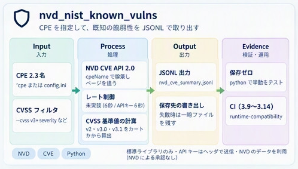
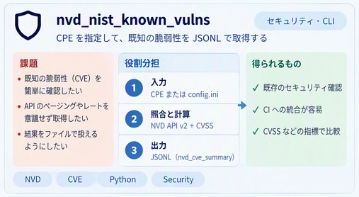

# NVD NIST known vulnerabilities

**Python compatibility:** CI-tested on Python 3.9–3.14.
Single-file, Python-standard-library client for the NVD CVE API 2.0. It fetches vulnerabilities for CPE 2.3 names and emits deterministic JSON Lines suitable for CLI use, CI, offline processing, and cross-repository adapters.

NVD’s public CVE REST stem remains `/rest/json/cves/2.0` (a `/cves/3.0` probe returns 404). This client stays on 2.0 and adds CVSS v3-series request filters plus local CVSS base-score calculation for v2 / v3.0 / v3.1 vectors.

## Concept overview



CPE 2.3 inputs are queried through the NVD CVE API 2.0 and normalized into JSONL. Requests are throttled to 6 seconds without an API key or 0.6 seconds with one. Optional CVSS filters and atomic file output are described below.

### Challenges, roles, and outcomes



Complementary view of CPE input, NVD/CVSS processing, and JSONL output. CVE results still require an applicability review; the client does not scan installed products or certify that a system is secure.

## Features

- NVD CVE API 2.0 with exact `cpeName` queries via command-line `--cpe` or `config.ini`.
- Optional CVSS v3-series filters: `--cvss-v3-severity` / `--cvss-v3-metrics` (NVD `cvssV3Severity` / `cvssV3Metrics`).
- Local CVSS base-score calculation for v2.0 / v3.0 / v3.1 vector strings (`calculate_cvss_base`); metric records also carry `calculated_base_score` when a vector is present.
- No third-party runtime dependencies.
- Pagination: results are not silently truncated to one page.
- Optional `NVD_API_KEY` header support.
- Rate-limit throttling, bounded retry/backoff for transient HTTP failures, and non-zero CLI failure status.
- Stable `nvd-cve-summary/1` JSONL records with CVSS v4/v3/v2, CWE, dates, and source identifier.
- Offline unit tests that run with `python -S`.

## Configure

`config.ini` keeps the existing CPE-list contract:

```ini
[cpeName]
cpe1 = cpe:2.3:a:openssl:openssl:1.1.1c:*:*:*:*:*:*:*
cpe2 = cpe:2.3:a:apache:log4j:1.2:-:*:*:*:*:*:*
```

## Run

```bash
python nvd_nist_known_vulns.py
python nvd_nist_known_vulns.py --cpe "cpe:2.3:a:openssl:openssl:1.1.1c:*:*:*:*:*:*:*"
# Repeat --cpe for multiple names; a value is never split at commas.
python nvd_nist_known_vulns.py --cpe "cpe:2.3:a:openssl:openssl:1.1.1c:*:*:*:*:*:*:*" --cpe "cpe:2.3:a:apache:log4j:1.2:-:*:*:*:*:*:*"
python nvd_nist_known_vulns.py --silent --output result.jsonl
python nvd_nist_known_vulns.py --config other.ini --timeout 30
python nvd_nist_known_vulns.py --cvss-v3-severity CRITICAL
```

An NVD API key is optional. When supplied it is read from the environment and sent as an HTTP header, not placed in the URL:

```bash
NVD_API_KEY=... python nvd_nist_known_vulns.py
```

## Reuse contract

The module is intentionally kept as one stdlib-only file. Other repositories may import `api_call`, `iter_cve_pages`, `format_cve_data`, `fetch_cves`, `calculate_cvss_base`, `parse_cpe_name`, `suggest_cpe_names`, `parse_jsonl`, `read_jsonl`, or `select_cpe_records`. The JSONL helpers validate completion evidence, distinguish an unmeasured/incomplete CPE from a measured zero-result CPE, and deduplicate a CVE that matches multiple selected CPEs. Network access is isolated from normalization so consumers can use captured NVD JSON fixtures in tests. `calculate_cvss_base` is pure and offline; it implements FIRST CVSS v2 / v3.0 / v3.1 base equations and rejects v4 MacroVector lookup vectors. `parse_cpe_name` parses CPE 2.3 strings into structured component attributes (part, vendor, product, version, etc.) and unescapes formatted values. `suggest_cpe_names` uses stdlib `difflib.get_close_matches` for spelling suggestions only.

### CPE parsing and suggestion contract

`parse_cpe_name(name)` validates the `cpe:2.3:` prefix, all eleven nonempty
attributes, part/language syntax, permitted quoting and wildcard positions from
[NISTIR 7695, Figure 6-3](https://doi.org/10.6028/NIST.IR.7695).
Invalid input raises `ValueError`. URI (`cpe:/`) bindings are not supported by
this helper. Syntax validation does not establish that a name exists in the
NVD dictionary or identifies an installed product.

The top-level attribute values are **unescaped display strings**. The additional
`raw_attributes` dictionary retains the exact field spellings. For example,
`*` means ANY, `-` means NA, and `\*` is a literal asterisk; the display values
of ANY and a literal asterisk are both `"*"`, so use the original CPE/raw fields
to retain that distinction. Unquoted `*` or runs of `?` may occur only at the
edges of a nonempty value (for example `1.*` or `??widget?`). Escaped colons and
backslashes remain within their attribute. This display parser is not a WFN
unbinder or an implementation of CPE Name Matching/applicability rules.

`suggest_cpe_names(target, candidates, n=3, cutoff=0.6)` compares **complete
original strings**, returning at most `n` unique original candidate strings in
`difflib.get_close_matches` order. The target must be a valid CPE formatted
string (not arbitrary free text). Invalid/non-string candidates are skipped;
`n` must be a positive integer and `cutoff` a number in `[0, 1]`; invalid target
or parameters raise `ValueError`. Wildcards are text here, not expanded patterns.

**Candidates are not confirmed matches.** Shared prefixes and wildcard fields
can give different vendors, products, or versions a high similarity. For example,
these two different vendors have similarity about 0.93 and can both appear at
`cutoff=0.8`:

```text
cpe:2.3:a:vendoralpha:widget:1.0:*:*:*:*:*:*:*
cpe:2.3:a:vendoromega:widget:1.0:*:*:*:*:*:*:*
```

Similarity is not a confidence/probability score. Even an identical spelling
does not itself prove vulnerability applicability. Consumers must verify the
vendor, product, version and other relevant attributes and explicitly select a
CPE before querying NVD; assess NVD applicability/configuration and version
constraints separately. Never automatically replace a query with a suggestion
or transfer another CPE's CVEs/completion evidence based on similarity.

Both helpers are pure/offline and are not called by `api_call`, `fetch_cves`,
the CLI, JSONL emission/parsing, or `select_cpe_records`. Existing query and JSONL
behavior stays unchanged: selection still uses explicit CPE strings and matching
query-completion evidence. No fuzzy results are added to the JSONL schema.

The emitted JSONL schema is versioned as `nvd-cve-summary/1`. Records use `kind: "cve"` or `kind: "query_complete"`. A successful CPE query emits its CVE records first and exactly one `query_complete` record afterward, including when the result count is zero. A completion record is emitted only after pagination has been validated as complete; if it is absent, consumers must treat that CPE as not measured or failed rather than as zero vulnerabilities. Early v1 CVE records without `kind` may be treated as `cve`. V1 consumers must dispatch on `kind` and ignore unknown kinds so future additive record kinds do not break them. Additive fields and record kinds following that rule may be introduced within v1; other incompatible shape changes require a new schema version. NVD `published` and `lastModified` timestamps are UTC values as supplied by NVD. CVSS selection prefers a `Primary` metric and records its `source` and `type`. When a metric includes a calculable vector, the record also adds `calculated_base_score` and `calculated_base_severity` beside the NVD-supplied score.

Network calls are throttled conservatively (6 seconds without an API key; 0.6 seconds with one). Transient 429/5xx responses and unauthenticated 403 responses are retried with bounded backoff. `--output` is written atomically: a failed run leaves an existing output file unchanged.

## Testing

```bash
python -S -m py_compile nvd_nist_known_vulns.py
python -S -m unittest discover -s tests -v
```

Tests are offline and do not consume NVD rate limits.

## Migration note

The original implementation used `requests` and printed Python `set` values. This revision removes that dependency and changes the machine-readable output to deterministic JSONL. The `config.ini` CPE input and `--silent` option remain supported.

## References

- NVD CVE API 2.0: https://nvd.nist.gov/developers/vulnerabilities
- NVD developer start: https://nvd.nist.gov/developers/start-here

## NVD notice

This product uses data from the NVD API but is not endorsed or certified by the NVD.

## License

MIT

## Test evidence

Install test-only tools with `python -m pip install -r tests/requirements.txt`.
CI preserves native pytest JSONL and JUnit while retaining the `python -S`
runtime isolation lane. See [recording and exploration](docs/pytest-observations.md).


### Filtered query completion

CVSS-filtered requests emit `filtered_cve` and `filtered_query_complete` kinds
within `nvd-cve-summary/1`. Both carry the same `query.filters`, using
`cvss_v3_severity` and/or `cvss_v3_metrics`; values are trimmed and uppercased
before both the request and JSONL output. The completion count belongs only to
that filtered request, including zero results. Unfiltered output keeps its
existing `cve` / `query_complete` kinds and CPE-only query unchanged.

This kind separation is required for older v1 readers, which ignore unknown
kinds: merely adding filter fields to `query_complete` would let them mistake
a filtered zero for a complete unfiltered measurement. `parse_jsonl` understands
the new kinds and rejects missing, invalid or ambiguous filter scopes.
`select_cpe_records` remains an **unfiltered** selector: filtered rows and query
restrictions do not supply completion, counts or CVE IDs. A snapshot with only
filtered evidence returns `not_measured`, and mixed snapshots use only the
unfiltered evidence. Consumers needing filtered results can inspect the explicit
filtered records returned by `parse_jsonl`.

The v1 additive-field policy does not make measurement identity open-ended.
For unfiltered `cve` and `query_complete` records, `query` must contain exactly
`cpe_name`; extra keys are intentionally rejected by `parse_jsonl`, even when
a producer considers them metadata. This tightens the earlier reader's
acceptance of extra query keys so an unknown restriction cannot certify an
unfiltered measurement. Put additive descriptive metadata outside `query`.
Filtered kinds use the explicit, validated `cpe_name` plus `filters` shape;
unknown record kinds remain ignored as required by the v1 contract.

When `--cpe` is provided, it replaces the CPE names from `config.ini`. Without it, an empty `[cpeName]` section is an error.

## Runtime and development Python policy

The standard-library runtime supports Python 3.9+; this change preserves the
existing runtime floor. The separate `runtime-compatibility` CI lane executes
behavior tests with `python -S`, without installing pytest or any third-party
package. Development/test environments use Python 3.11+ and a committed uv lock:

```sh
uv sync --locked --python 3.11
uv run --locked python -m pytest
python -S -m unittest discover -s tests -p test_nvd_client.py -v
```

`pyproject.toml` is the canonical development dependency definition. The runtime
has no third-party dependencies, and `tests/requirements.txt` lists only the
test-only tools. Runtime metadata does not
raise the source/vendoring floor to the development floor. CI pins setup-python
v7.0.0 and setup-uv v10.3.0 by full commit SHA, and uses uv 0.13.3. Setup actions
using Node 24 require runner 2.327.1 or newer (GitHub-hosted runners are used).

CI also exercises the stdlib runtime floor and Python 3.14 on Windows and macOS.
Dependency-bearing portability tests use locked uv environments on Python 3.11+;
raw JUnit reports from both operating systems are required by the identity collector.
